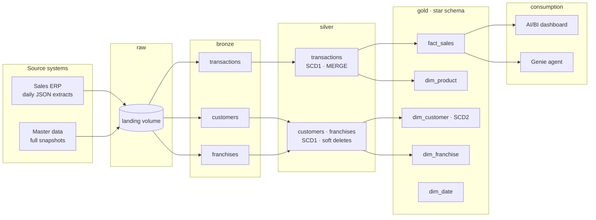
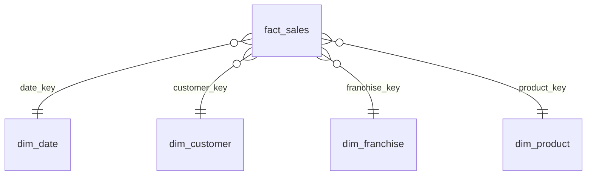
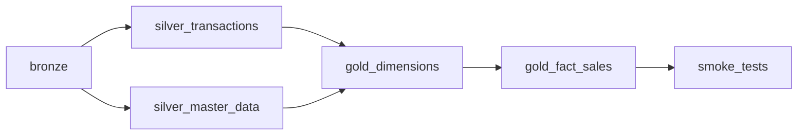

# Bakehouse Lakehouse on Databricks

End-to-end, production-style data platform on Databricks: incremental ingestion with
Auto Loader, a medallion architecture on Unity Catalog, a Kimball star schema with
SCD Type 2, data quality and audit logging, orchestrated with Lakeflow Jobs and
deployed as code with Declarative Automation Bundles.

The same sales flow is implemented twice, **imperatively** (notebooks + Delta `MERGE`)
and **declaratively** (Lakeflow Declarative Pipelines), and both produce identical results.

---

## Architecture



Operational tables in the `ops` schema support every layer: run audit log, data quality
issues and watermarks for incremental loads.

## Tech stack

| Area | Technology |
|---|---|
| Platform | Databricks (serverless), Unity Catalog |
| Storage | Delta Lake, liquid clustering, volumes |
| Processing | PySpark, Spark SQL |
| Ingestion | Auto Loader (schema hints, schema evolution, rescued data) |
| Transformations | Delta `MERGE` (imperative) · Lakeflow Declarative Pipelines with AUTO CDC (declarative) |
| Orchestration | Lakeflow Jobs |
| Deployment | Declarative Automation Bundles (dev / prod targets), Git folders |
| Consumption | AI/BI dashboards, Genie |

## Data model



- **Grain:** one row per sale (`transaction_id`).
- **Surrogate keys** (identity columns) in every dimension; `date_key` as `yyyymmdd`.
- **Unknown member (`-1`)** in every dimension: facts are never dropped when master data arrives late.
- **`dim_customer` is SCD Type 2**: location changes create a new version; email changes are overwritten
  on the current version. Sales are linked to the customer version **valid at the time of the sale**
  (point-in-time lookup).
- Informational primary and foreign keys document the model and are used by Genie to infer joins.

## Key engineering decisions

| Decision | Why |
|---|---|
| Bronze keeps everything as received, plus lineage columns (`_ingested_at`, `_source_file`, `_run_id`) | Reprocessing without re-extracting from the source; full traceability from any row to its file and run |
| Schema hints on critical columns | Inferred types depend on the files present at the first load; hints make them deterministic |
| Silver is defined by explicit DDL (data contract), never inferred | Source changes do not propagate silently to gold and BI |
| `MERGE` only when the incoming version is newer (`_change_ts`) | Out-of-order or reprocessed data never overwrites newer data; re-runs are idempotent |
| Master data loaded as full snapshots with a row hash | Only changed rows are written; deletions are detected and soft-deleted |
| Guard against incomplete snapshots | An empty or partial extract aborts instead of soft-deleting most of the table |
| Append-only audit log and watermarks | No update conflicts between concurrent tasks; a stuck task stays visible as `RUNNING` |
| Errors are logged and re-raised | The orchestrator always sees real failures (no swallowed exceptions) |
| Failure isolation in bronze | One failing source does not block the others; the task fails at the end listing them |
| Catalog passed as a parameter everywhere | The same code runs in dev and prod; only the bundle target changes |
| Fail-fast parameter validation | A missing parameter fails at the first cell with a clear message |

## Data quality and observability

- **Row-level rules** in silver (null keys, non-positive quantities, rescued data). Rejected or flagged
  records are stored with the broken rule and the full record as JSON in `ops.data_quality_issues`.
- **Enforced constraints** (`CHECK`, `NOT NULL`) as the last line of defence.
- **Dataset-level smoke tests** as the last task of the job: uniqueness, silver-to-gold reconciliation
  (row counts and revenue), unknown members, one current version per customer and no gaps or overlaps
  in SCD2 history. Errors fail the job; warnings are reported.
- **Audit log** (`ops.pipeline_runs` / `ops.v_pipeline_runs`): status, rows read / written / rejected,
  duration and the orchestrator `job_run_id` for every task.

## Orchestration



`bakehouse_daily` (Lakeflow Job): daily schedule, retries with back-off (none for tests), task and job
timeouts, duration alerts, `max_concurrent_runs = 1` (watermark-based loads never overlap), cost
attribution tags and failure notifications. Defined in `resources/bakehouse_daily.job.yml`.

## Imperative vs declarative

The sales flow and the customer SCD2 are also implemented as a Lakeflow Declarative Pipeline
(`pipelines/bakehouse_declarative`): expectations instead of custom quality code, AUTO CDC for
SCD1 and SCD2, and a materialized view for the gold aggregate.

| Check | Imperative | Declarative |
|---|---|---|
| Silver sales | 3,333 | 3,333 |
| Silver revenue | $66,531.00 | $66,531.00 |
| Invalid rows quarantined | 6 | 6 |
| Customers with history (SCD2) | 6 (12 versions) | 6 (12 versions) |

Note: AUTO CDC sets `__START_AT` from `sequence_by`, so the first version of a customer does not cover
facts older than the first snapshot; a point-in-time join over it needs a view that extends the first version.

## Reproducibility: rebuilt from scratch

The whole environment was dropped and rebuilt using only this repository
(setup notebooks → source simulator → bundle deploy → job run).

| Run | What arrived | Result |
|---|---|---|
| 1 | 5 daily sales extracts + master data snapshot 1 | 3,359 rows in bronze → 3,333 in silver (20 corrections merged, 6 rejected) → 3,333 facts; all smoke tests passed |
| 2 | Master data snapshot 2 (6 customers move, 8 change email) | Silver writes only the 12 changed customers; `dim_customer` writes 18 rows (6 closed + 6 new versions + 6 in-place email updates); every other table writes 0 |

## Project structure

```
├── databricks.yml                     # bundle: variables and dev / prod targets
├── resources/
│   ├── bakehouse_daily.job.yml        # orchestration job
│   └── bakehouse_declarative.pipeline.yml
├── src/
│   ├── lib/                           # reusable, documented Python modules
│   │   ├── audit.py                   # run audit context manager
│   │   ├── config.py                  # environment configuration
│   │   ├── delta_utils.py             # MERGE metrics
│   │   ├── dimensions.py              # SCD1 / SCD2 patterns
│   │   ├── ingestion.py               # Auto Loader ingestion
│   │   ├── master_data.py             # snapshot selection and SCD1 merge
│   │   ├── quality.py                 # data quality logging
│   │   └── watermarks.py              # incremental load control
│   ├── 00_setup_platform / _silver / _gold   # idempotent DDL (data contracts)
│   ├── 01_source_simulator            # simulated source systems (not part of the job)
│   ├── 02_bronze                      # metadata-driven ingestion
│   ├── 03_silver_transactions / _master_data
│   ├── 04_gold_dimensions / _fact_sales
│   ├── 98_reset_environment           # dev-only reset with safeguards
│   └── 99_smoke_tests                 # dataset-level data tests
├── pipelines/bakehouse_declarative/   # declarative version
└── dashboards/                        # AI/BI dashboard definition
```

## How to run

Requirements: a Databricks workspace with Unity Catalog (Databricks Free Edition works) and the
Databricks CLI (available in the workspace web terminal).

1. Add this repository as a **Git folder** in the workspace.
2. Run the setup notebooks with `catalog = <your catalog>`:
   `00_setup_platform` → `00_setup_silver` → `00_setup_gold`.
3. Deploy the bundle:
   ```bash
   databricks bundle validate -t dev
   databricks bundle deploy -t dev
   ```
4. Generate source data with `01_source_simulator` (`sales_batch = all`, `master_snapshot = 1`).
5. Run the job `[dev <user>] bakehouse_daily`.
6. To see SCD2 in action: run the simulator with `master_snapshot = 2` and run the job again.
7. Optional: run the declarative pipeline and compare with the imperative version.

The `prod` target documents how the project is promoted (CI/CD from `main`, service principal,
schedule enabled); it is not deployable in Free Edition.

## Consumption

- **AI/BI dashboard** (`dashboards/`): KPIs (revenue, transactions, units, average ticket),
  revenue over time, by product, by store and by payment method.
- **Genie agent** over the gold star schema, with business definitions (revenue, average ticket),
  SCD2 rules (count `customer_id`, not `customer_key`; point-in-time vs current attributes),
  curated example queries and a benchmark used as a regression test.

## Future work

- Pipeline health page in the dashboard (built on `ops` tables).
- Dynamic Top N with dashboard parameters.
- Unit tests for `src/lib` with pytest and Databricks Connect.
- CI/CD with GitHub Actions (`bundle validate` on pull requests, `bundle deploy -t prod` on merge).

## Author

**Tomás Reyna Novillo** · Senior Data Engineer · [LinkedIn](<https://www.linkedin.com/in/tomasreynanovillo/>)